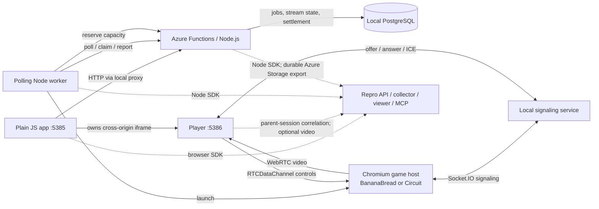

# YOM Streaming Demo

A runnable reference for YOM's Node.js polling worker, Azure Functions backend, and plain-JavaScript streaming player. It demonstrates Repro integration around the platform, **not instrumentation inside the game**. It is not a replica of YOM's production architecture.

## Architecture



**One launch:** Functions inserts a job; the worker claims it, checks capacity and starts the game host. Socket.IO negotiates WebRTC. The iframe receives video and sends controls; Functions settles the session when it ends. PostgreSQL stores business data, not Repro recordings. Azurite emulates Azure Storage locally.

## Integrations And YOM Mapping

| Integration | What runs here / how capture works | Compare with YOM |
| --- | --- | --- |
| Plain JS | Browser SDK initializes before app/network code in `public/app/repro.mjs`. Captures DOM replay, UI actions and HTTP evidence; no React required. | Same integration point in your streaming website. |
| Owned cross-origin iframe | SDK also initializes inside the player. Explicit parent/child origin checks associate iframe evidence with the parent's recording. | You confirmed the player page can include the SDK. Use your real origins. |
| WebRTC + optional video | Real video tracks and input data channel. Captures connection/statistics evidence; optional media records presented gameplay alongside replay. rrweb alone does not reproduce game pixels. | Uses local Chromium instead of your native game/GPU host; no TURN, cloud networking or codec-scale validation. |
| Socket.IO | Exchanges signaling messages; SDK observes underlying WebSocket lifecycle. | Not a promise to capture arbitrary Socket.IO event bodies. Compare your signaling and reconnect flow. |
| Polling Node worker | A separate child process polls HTTP and runs jobs without an HTTP listener. Node SDK starts before worker imports. `job-transport.mjs` publishes enqueue/dispatch hooks and carries context through the stored job. | This small adapter is for our custom queue. Map it to your job envelope/transport; arbitrary polling cannot infer job boundaries automatically. No per-business-function wrappers. |
| Azure Functions | Actual Node programming model v4, run by Core Tools. SDK initializes before function registration. Requests, invocation traces and database evidence follow browser admission. Export uses an SDK-managed Storage queue; not an Express backend. | Validate your trigger types, Node/runtime version, storage permissions and hosting plan. This demo exercises HTTP triggers, not every Azure trigger. |
| PostgreSQL | Job claims use leases; stream state, input acknowledgements and settlements are persisted. Repro captures queries/results. | A demo database choice, not an assumption about YOM's database. |

All browser users share a **synthetic demo actor**. Production needs your authenticated actor IDs, capture policy and real queue/auth contracts. This localhost demo is not a production deployment template.

## Run Locally

Requires **Node 22**, **Docker running**, and Chrome/Chromium. Validated on macOS; process-group shutdown also assumes a Unix-like OS. No Azure subscription, Tilt, Repro account or cloud database is needed for the baseline.

```sh
git clone git@github.com:getrepro/repro-yom-demo-app.git
cd repro-yom-demo-app
npm ci
npx playwright install chromium
npm run game:install
cp .env.example .env.local
npm run dev
```

Open **http://127.0.0.1:5385**. Launch a game, play, then end the session. Ctrl+C stops the worker, Functions and disposable containers; demo business data is discarded. First startup downloads the Functions extension bundle. Ports are configurable in `.env.local`.

BananaBread is an existing open-source FPS downloaded at a pinned commit; see [game notices](GAME-NOTICES.md). Circuit is the smaller synthetic game used for fault tests. Neither requires modifying the original game to capture the surrounding platform.

## Enable Repro

**The public npm releases checked for this handoff do not include the YOM browser/iframe and worker/Azure features.** Obtain the two feature-package tarballs and a compatible Repro environment from Repro first. SDK source and private credentials are deliberately not included.

```sh
npm install --no-save --package-lock=false --legacy-peer-deps /path/to/node-sdk-feature.tgz /path/to/react-sdk-feature.tgz
```

In `.env.local`, set `REPRO_ENABLED=true` and fill in your application's IDs, server-side app secret, API, collector and viewer URLs. Restart `npm run dev`. The pre-release packages have broad framework peer requirements; `--legacy-peer-deps` avoids applying those to this plain-JS app. Startup rejects missing feature packages; reinstall them after `npm ci`.

| Setting | Effect |
| --- | --- |
| `REPRO_CAPTURE_MODE=staging` | Authenticate in the Repro widget, start recording, launch/play/end a game, then Stop & Report. Promote in the viewer if requested. |
| `REPRO_CAPTURE_MODE=live`, `REPRO_SAMPLE_RATE=1` | Automatically captures admitted activity; use 0-1 sampling. Browser-driven Functions follow that admission; the worker restores the job's capture context. |
| `REPRO_MEDIA_ENABLED=true` | Adds gameplay video. Requires a media-enabled Repro API and storage configured by Repro. Optional `REPRO_MEDIA_API_BASE_URL` overrides the API for media routes. |
| `REPRO_CAPTURE_RAW=true` | Suitable only for this synthetic demo. For real data, use an approved policy and matching `REPRO_PRIVACY_ENVIRONMENT`, then disable raw capture. |

After recording, inspect replay/video, UI actions, Functions requests/traces, worker execution and database evidence in Repro. Your AI agent can investigate the same session through Repro MCP; the MCP server is not part of this app. Media upload can finish after gameplay ends; the retiring iframe is kept attached while it drains.

## Scenarios And Checks

| Select in the app | Expected incident |
| --- | --- |
| Healthy session | Video, controls and settlement agree with the contract. |
| No GPU capacity / Capacity service unavailable | Explicit failure, no successful allocation or charge. Capacity check retries recovers from one transient 503. |
| Wrong stream quality | Requested 720p, actual 540p; launch still succeeds. |
| Wrong session rate | Successful settlement charges EUR 0.30/min instead of EUR 0.20/min: a silent business bug. |
| Game host freezes / Player stops presenting | Distinguishes a stopped source from a paused display while network traffic continues. |
| Input delivery delayed / Freeze after three minutes | 750 ms control delay / source freeze after 185 seconds. |

`npm test`: domain/configuration safety. `npm run test:e2e`: real PostgreSQL/Azurite, Functions, worker, Chromium, WebRTC and failure/recovery paths. `npm run test:game`: actual FPS video, controls and settlement. Both browser suites force capture off.

After installing the feature SDKs, `npm run test:capture` verifies correlated SDK evidence against a **local admission/ingest stub**. It does not verify remote persistence, media storage, billing or viewer completion; inspect a recording in the configured Repro environment for those.

## File Map

| File(s) | Purpose |
| --- | --- |
| `src/bootstrap.mjs` | Loads private `.env.local`, validates optional capture, selects startup mode. |
| `src/dev.mjs` / `src/start.mjs` | Disposable full demo / existing dedicated local PostgreSQL via `YOM_DEMO_DATABASE_URL` and `npm start`. |
| `src/server.mjs` | Static app/player origins, Functions HTTP proxy, Socket.IO signaling and disconnected-player cleanup. |
| `src/repro-config.mjs` | SDK configuration, feature-build checks, safe browser config and worker initialization. |
| `src/agent.mjs` | Polls/claims jobs, allocates and manages Chromium game hosts. This is the demo worker, not an AI agent. |
| `src/agent-process.mjs` / `src/fork-agent.mjs` | Initialize capture before worker code; spawn and gracefully drain the independent worker process. |
| `src/job-transport.mjs` | Custom polling queue's enqueue/dispatch correlation adapter. |
| `src/capacity.mjs` | Worker-side capacity request and bounded retry. |
| `src/store.mjs` | PostgreSQL schema, atomic claims, lease validation, state and idempotent settlement. |
| `src/domain.mjs` | Catalog, validation, pricing/quality rules and explicit fault scenarios. |
| `azure/bootstrap.mjs` | Initialize Node SDK before importing Functions; select durable export. |
| `azure/streaming.mjs` / `azure/capacity.cjs` | Business HTTP functions / capacity allocation function and injected failures. |
| `azure/host.json` / `azure/package.json` | Functions host/Storage bindings and Node entry point. |
| `public/app/index.html` / `style.css` / `app.mjs` | Game library, scenario controls, launch, iframe lifecycle and settlement UI. |
| `public/app/repro.mjs` / `bananabread.jpg` | Parent browser SDK initialization / game preview image. |
| `public/player/index.html` / `player.mjs` | Owned player, WebRTC receiver, controls, stats and graceful shutdown. |
| `public/player/repro.mjs` | Joins the parent recording and identifies the gameplay video element. |
| `public/player/host.html` / `host.mjs` | Circuit game rendering and input on the worker's host. |
| `public/player/bananabread.html` / `bananabread.mjs` | Hosts the existing FPS and maps incoming controls to its engine. |
| `public/player/stream-host.mjs` | Shared host-side video sender, data channel and fault injection. |
| `scripts/azure-local.mjs` | Starts/stops Core Tools and Azurite; initializes local capacity storage. |
| `scripts/install-game.mjs` / `GAME-NOTICES.md` | Pinned, hash-checked game installer / upstream attribution and licenses. |
| `test/domain.test.mjs` / `config.test.mjs` | Domain and SDK configuration regression tests. |
| `test/streaming.testcontainers.mjs` / `real-game.testcontainers.mjs` | Browser/container integration tests / actual FPS smoke test. |
| `test/capture.testcontainers.mjs` | Optional installed-SDK integration test, with local synthetic admission and ingest acknowledgements. |
| `.env.example` / `.nvmrc` / `.gitignore` | Safe configuration template, Node version, private/generated-file exclusions. |
| `package.json` / `package-lock.json` / `README.md` | Dependencies/commands, reproducible dependency tree and this integration guide. |

Generated `vendor/`, `artifacts/`, `node_modules/` and private `.env.local` stay untracked. No Repro backend, SDK source, production credentials, session exports or internal infrastructure tools are shipped.
