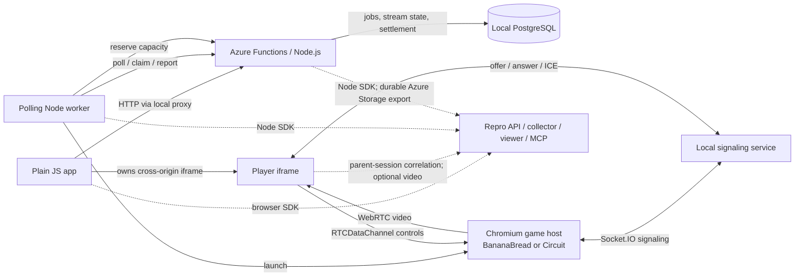

# YOM Streaming Demo

A streaming demo showing how to integrate Repro with a Node.js polling worker, Azure Functions, and a plain-JavaScript player. Follow a game session from browser actions through backend execution to gameplay video and debugging evidence.

## Architecture

**One launch:** Functions inserts a job; the worker claims it, checks capacity and starts the game host. Socket.IO negotiates WebRTC. The iframe receives video and sends controls; Functions settles the session when it ends. PostgreSQL stores jobs, stream state and settlements. Azurite emulates Azure Storage locally.

BananaBread is an existing open-source FPS; Circuit is the smaller game used for fault scenarios. Both run on the worker's game host. See [game notices](GAME-NOTICES.md) for upstream attribution.

## Integrations And YOM Mapping

| Integration | What runs here / how capture works | Compare with YOM |
| --- | --- | --- |
| Plain JS | Browser SDK initializes before app/network code in `public/app/repro.mjs`. Captures DOM replay, UI actions and HTTP evidence. | Initialize the SDK at the same point in your streaming website. |
| Owned cross-origin iframe | SDK also initializes inside the player. Parent/child origin checks associate iframe evidence with the parent's recording. | Initialize the SDK in both pages and configure your parent/player origins. |
| WebRTC + optional video | Video tracks carry gameplay; a data channel carries controls. Repro captures connection statistics and optionally records presented gameplay alongside DOM replay. | This demo uses a local Chromium game host and direct ICE connections. Keep your game host and player ICE/STUN/TURN configuration. |
| Socket.IO | Exchanges signaling messages. Captured evidence covers the underlying WebSocket connection lifecycle. | Map this to your signaling and reconnect flow. |
| Polling Node worker | A separate child process polls HTTP and runs jobs without an HTTP listener. Node SDK starts before worker imports. `job-transport.mjs` publishes enqueue/dispatch hooks and carries context through the stored job. | Connect the transport adapter to your job envelope and polling mechanism. |
| Azure Functions | Node programming model v4 HTTP triggers, run by Core Tools. SDK initializes before function registration. Requests, invocation traces and database evidence follow browser admission. Export uses an SDK-managed Storage queue. | Map the bootstrap to your Functions entry point and configure Azure Storage access for export. |
| PostgreSQL | Job claims use leases; stream state, input acknowledgements and settlements are persisted. Repro captures queries/results. | Compare the demo's job and settlement storage with your existing data layer. |

## How Evidence Stays Connected

The parent page starts the recording and shares its session context with the owned player iframe. HTTP correlation links browser activity to Azure Functions. The queue adapter stores that context with the job and restores it when the worker executes the job.

Repro's viewer brings together UI replay, optional gameplay video, requests, function traces and database evidence. The same session is available to an AI agent through Repro MCP. When gameplay ends, the iframe remains attached until its capture uploads finish.

## Demo Scenarios

| Scenario | What it demonstrates |
| --- | --- |
| Healthy session | Video, controls and settlement agree with the contract. |
| No GPU capacity / Capacity service unavailable | Explicit failure, no successful allocation or charge. Capacity check retries recovers from one transient 503. |
| Wrong stream quality | Requested 720p, actual 540p; launch still succeeds. |
| Wrong session rate | Successful settlement charges EUR 0.30/min instead of EUR 0.20/min: a silent business bug. |
| Game host freezes / Player stops presenting | Distinguishes a stopped source from a paused display while network traffic continues. |
| Input delivery delayed / Freeze after three minutes | 750 ms control delay / source freeze after 185 seconds. |

## File Map

| File(s) | Purpose |
| --- | --- |
| `src/bootstrap.mjs` | Loads `.env.local`, validates optional capture, selects startup mode. |
| `src/dev.mjs` / `src/start.mjs` | Start the application with disposable or existing local PostgreSQL. |
| `src/server.mjs` | Static app/player origins, Functions HTTP proxy, Socket.IO signaling and disconnected-player cleanup. |
| `src/repro-config.mjs` | SDK options, browser-safe configuration and worker initialization. |
| `src/agent.mjs` | Polls/claims jobs, allocates and manages Chromium game hosts. |
| `src/agent-process.mjs` / `src/fork-agent.mjs` | Initialize capture before worker code; spawn and gracefully drain the independent worker process. |
| `src/job-transport.mjs` | Custom polling queue's enqueue/dispatch correlation adapter. |
| `src/capacity.mjs` | Worker-side capacity request and bounded retry. |
| `src/store.mjs` | PostgreSQL schema, atomic claims, lease validation, state and idempotent settlement. |
| `src/domain.mjs` | Catalog, validation, pricing/quality rules and explicit fault scenarios. |
| `azure/bootstrap.mjs` | Initialize Node SDK before importing Functions; select durable export. |
| `azure/streaming.mjs` / `azure/capacity.cjs` | Business HTTP functions / capacity allocation function and injected failures. |
| `azure/host.json` / `azure/package.json` | Functions host/Storage bindings and Node entry point. |
| `public/app/index.html` / `style.css` / `app.mjs` | Game library, scenario controls, launch, iframe lifecycle and settlement UI. |
| `public/app/repro.mjs` / `bananabread.jpg` | Parent browser SDK initialization / game preview image. |
| `public/player/index.html` / `player.mjs` | Owned player, WebRTC receiver, controls, stats and graceful shutdown. |
| `public/player/repro.mjs` | Joins the parent recording and identifies the gameplay video element. |
| `public/player/host.html` / `host.mjs` | Circuit game rendering and input on the worker's host. |
| `public/player/bananabread.html` / `bananabread.mjs` | Hosts the existing FPS and maps incoming controls to its engine. |
| `public/player/stream-host.mjs` | Shared host-side video sender, data channel and fault injection. |
| `scripts/azure-local.mjs` | Starts/stops Core Tools and Azurite; initializes local capacity storage. |
| `scripts/install-game.mjs` / `GAME-NOTICES.md` | Pinned, hash-checked game installer / upstream attribution and licenses. |
| `test/domain.test.mjs` / `config.test.mjs` | Domain and SDK configuration regression tests. |
| `test/streaming.testcontainers.mjs` / `real-game.testcontainers.mjs` | Browser/container integration tests / actual FPS smoke test. |
| `test/capture.testcontainers.mjs` | Optional installed-SDK integration test, with local synthetic admission and ingest acknowledgements. |
| `.env.example` / `.nvmrc` / `.gitignore` | Safe configuration template, Node version, private/generated-file exclusions. |
| `package.json` / `package-lock.json` / `README.md` | Dependencies/commands, reproducible dependency tree and this integration guide. |
